<div align="center">
  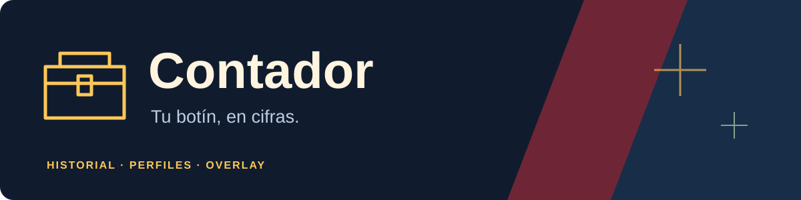
  <h1>Contador de cofres para Fortnite</h1>
  <p>Tu historial de cofres, en una app de Windows.<br>Partidas, mapa interactivo, rutas, informe y overlay en un solo ejecutable.</p>
  <p>
    
    
    <a href="https://github.com/Axxon-g/contador-cofres-fornite/releases"></a>
    
    <a href="LICENSE"></a>
  </p>
  <p>
    <a href="https://github.com/Axxon-g/contador-cofres-fornite/releases/latest/download/Contador.exe"></a>
  </p>
  <p><a href="https://github.com/Axxon-g/contador-cofres-fornite/releases">Todas las versiones</a> · <a href="#antes-de-abrir-seguridad-y-aviso-de-windows">Seguridad y SmartScreen</a> · <a href="#primeros-pasos">Primeros pasos</a> · <a href="#preguntas-frecuentes">Preguntas frecuentes</a> · <a href="https://github.com/Axxon-g/contador-cofres-fornite/issues">Informar de un problema</a></p>
  <p><strong>Sin cuentas ni contraseñas. Análisis local en tu equipo.</strong></p>
  <p><sub>La insignia suma las descargas de Contador.exe en todas las versiones publicadas. No cuenta personas únicas y puede tardar en reflejar nuevas descargas.</sub></p>
</div>

> [!IMPORTANT]
> Los cofres se cuentan **al terminar la partida**, cuando Fortnite finaliza la repetición. Debes tener activada la opción **Grabar repeticiones**. Las rutas sugeridas son contenido editorial de la comunidad: no detectan cofres ni predicen premios.

## Contador 1.3 · Explora el mapa, prepara tu ruta y consulta tu botín

La actualización 1.3 reúne el mapa interactivo con terreno HD, rutas editables e informe nativo. El contador conserva el recuento por cuenta, el historial y los overlays para jugar o transmitir.

| Novedad | Qué puedes hacer |
|---|---|
| **Terreno HD por defecto** | Ver piezas de mayor resolución al acercar, con caché local y respaldo integrado. |
| **Zoom hasta 3200 %** | Explorar zonas y separar grupos de ubicaciones. |
| **Rutas editables** | Añadir y mover paradas, marcar puntos revisados y deshacer cambios. |
| **Informe nativo** | Consultar cifras, gráficos y tesoros sin salir de la app. |
| **Cuentas y fechas** | Revisar las estadísticas del perfil y período elegidos. |
| **Inicio corregido** | Recuperar bloqueos abandonados y solicitar la ventana al abrir una segunda instancia. |

Consulta las [notas de Contador 1.3](docs/RELEASE-v1.3.0.md).

> [!NOTE]
> Este README prepara la publicación 1.3. El botón de descarga apunta a la última Release publicada, que puede seguir siendo anterior. El ejecutable local actual aún está versionado como 1.2.7; antes de publicar 1.3 hay que actualizar su versión y recompilarlo.

### Terreno HD al acercar

**Terreno HD · Internet** viene activado por defecto para cargar piezas de mayor resolución de Fortnite.GG dentro del mapa propio. El zoom llega hasta **3200 %** y la caché local reutiliza lo descargado. Puedes desactivarlo desde la barra del mapa; si una pieza falla, permanece el mapa integrado. Es un servicio externo opcional, sin clave ni inicio de sesión, cuya disponibilidad puede variar. Mejorar la imagen no verifica ni actualiza las posiciones comunitarias. Consulta [fuentes, privacidad y límites del modo HD](docs/MAPA-HD-1.2.7.md).

<p align="center">
  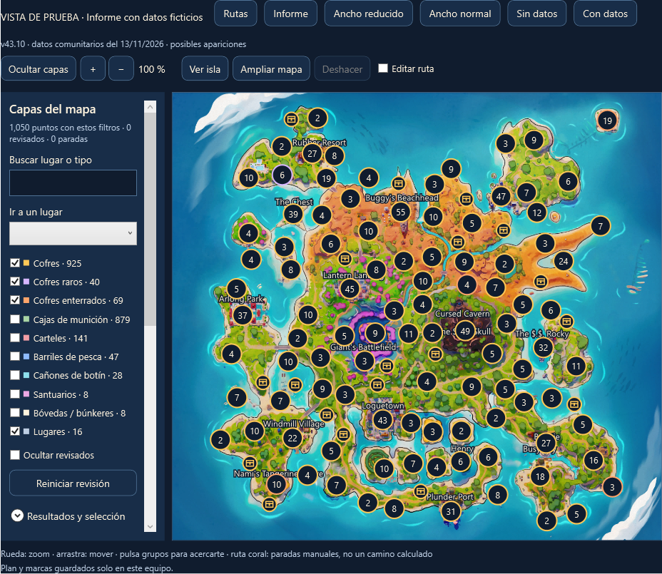
  <br><sub>Vista renderizada de la interfaz real. El mapa utiliza una instantánea comunitaria de ubicaciones posibles.</sub>
</p>

**Mapa y rutas** es un mapa propio integrado en la aplicación, inspirado en la interacción de Fortnite.GG: rueda y botones para acercar, arrastre, capas, búsqueda, selección de puntos y una ventana ampliada. Funciona sin conexión con una imagen de 2048 × 2048 píxeles y un catálogo comunitario de **2.146 referencias de botín**, más 16 lugares de referencia, para Treasure Hunters **43.10**.

- **Nueve capas de botín:** 925 cofres, 40 raros, 69 enterrados, 879 cajas de munición, 141 carteles, 47 barriles de pesca, 28 cañones de botín, 8 santuarios y 9 bóvedas orientativas. Las bóvedas se corrigieron a partir de una imagen aportada y son posiciones aproximadas; conservan su ancla aunque actives otras capas. Los grupos muestran cuántos registros contienen; al acercarte puedes seleccionar los puntos individuales, incluidos los coincidentes.
- **Tu ruta:** activa Editar ruta para añadir paradas con un clic o moverlas arrastrando. También puedes añadir un punto seleccionado, quitar paradas, vaciar o deshacer cambios. Las líneas unen tus paradas; no calculan un camino transitable ni evitan la tormenta.
- **Revisión manual:** marca puntos como revisados, vacíos o pendientes y oculta lo ya revisado. Reiniciar revisión y vaciar la ruta se pueden deshacer. Esto no modifica el recuento real de cofres.
- **Controles:** usa +/− o la rueda hasta 3200 %, las flechas y la tecla Inicio con el mapa enfocado. Ampliar mapa abre una ventana maximizada. Esc sale de edición; en la ventana ampliada, otro Esc la cierra. Los puntos coincidentes se distinguen en el selector de puntos próximos.

- **Evidencia visible:** se distingue un testimonio de hallazgo, una recomendación de jugadores y una guía de localizaciones. No existe un conjunto comparable que permita clasificar dónde se han obtenido más recompensas.
- **Datos y procedencia:** posiciones publicadas por [Crisis](https://lifecrisis.life/loot), consultadas el 13/11/2026; imagen servida por [Fortnite-API](https://fortnite-api.com/). Es una copia fija integrada, con atribución, no una conexión al juego ni una copia del código o iconos de Fortnite.GG. No se ha verificado cada aparición dentro de una partida; faltan alturas, plantas y probabilidades por punto.
- **Rutas sugeridas:** conserva The Chest–Arlong Park, Lantern Landing, norte de Plunder Port y Windmill Village–Loguetown. Puedes cargarlas como punto de partida y editarlas. Sus paradas editoriales se distinguen de los registros de apariciones.
- **Guardado local:** ruta, capas y revisiones se guardan en un archivo de planificación separado dentro de la carpeta de datos. No cambia tu historial. Las actualizaciones del juego pueden dejar obsoleto este catálogo; consulta su versión y fecha. Abrir fuentes necesita Internet.
- **Informe:** un nuevo apartado nativo muestra total, sesión, media, récord, gráfico de los últimos 30 días, tipos de cofre, otras interacciones, orígenes, tesoros propios y del equipo y últimas 100 partidas. Comparte la cuenta y las fechas de Ajustes. Los tesoros del equipo son estimaciones y no se suman a tus propios totales. El botón **Abrir versión HTML** conserva el informe externo.

Las guías buscan organizar la búsqueda de cofres, **no prometen premios ni una probabilidad superior por lugar**. Los relatos de Reddit son experiencias individuales, no estadísticas verificadas. Consulta la [investigación y las fuentes](docs/RUTAS-1.2.7.md).

### Explora, organiza y consulta

**Corrección de bóvedas:** se sustituyeron las ocho posiciones anteriores por nueve referencias visuales aproximadas, contrastadas con la imagen aportada. No representan entradas verificadas ni recalibran las demás capas.

<p align="center">
  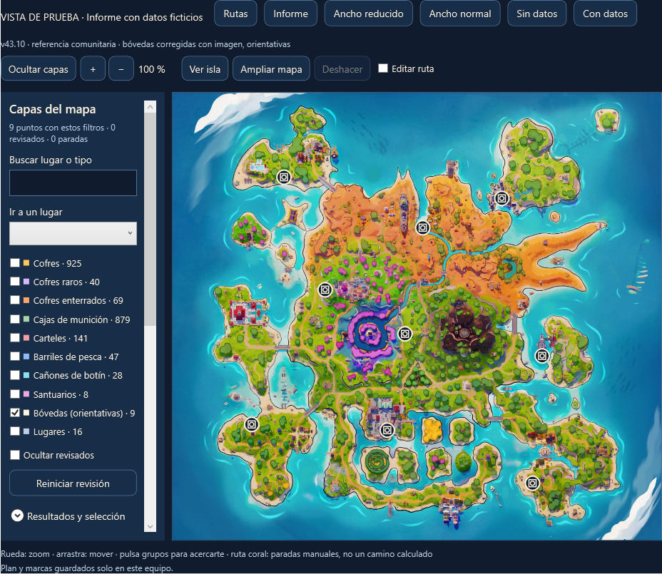
</p>

<table>
  <tr>
    <td width="50%">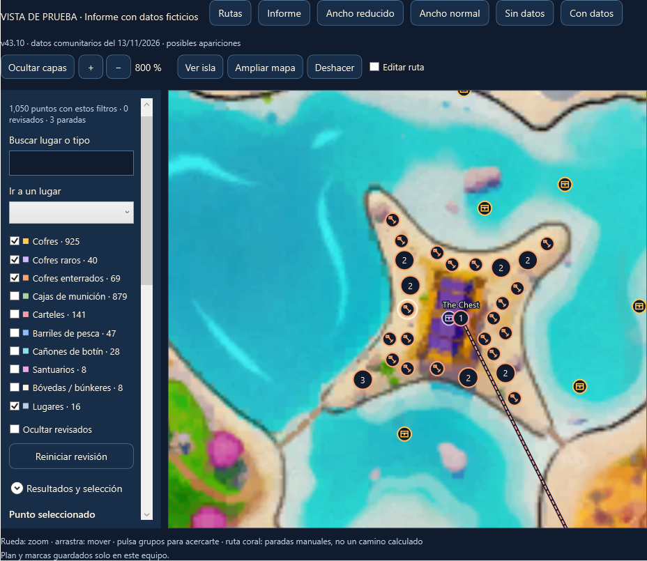<br><strong>Acércate a cada zona.</strong><br>Selecciona puntos y distingue los registros agrupados.</td>
    <td width="50%">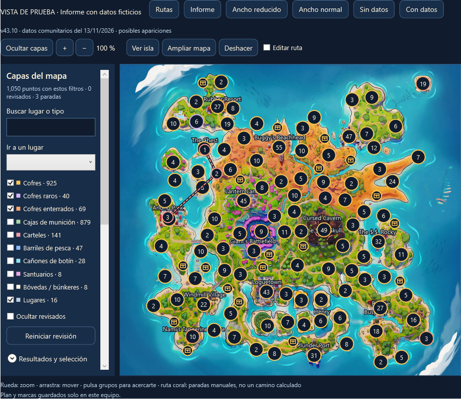<br><strong>Prepara tu recorrido.</strong><br>Añade y mueve paradas; deshaz los cambios cuando lo necesites.</td>
  </tr>
</table>

<p align="center">
  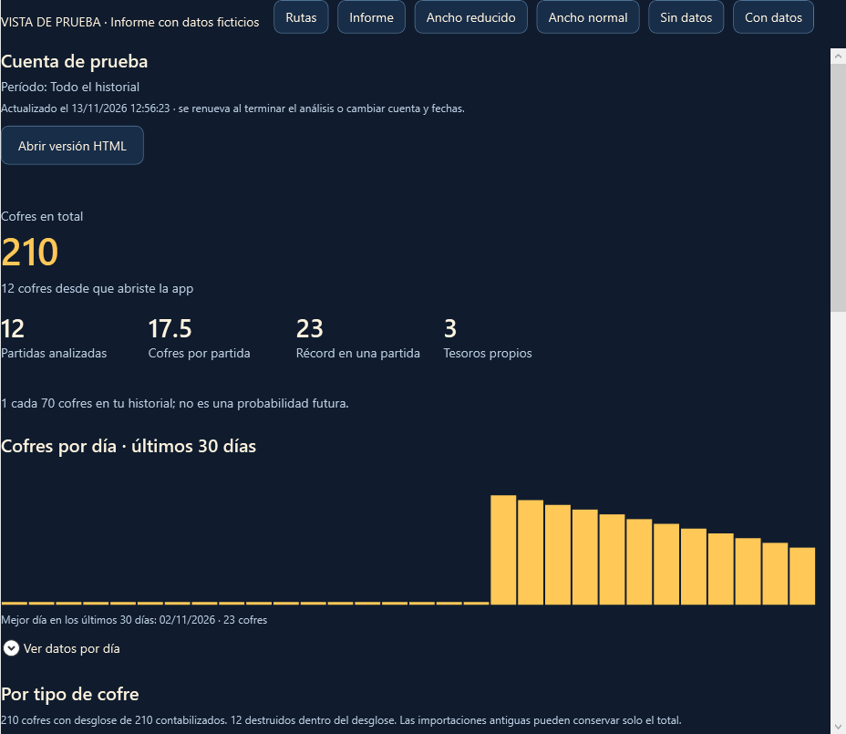
  <br><sub>Informe nativo con datos ficticios de demostración. La barra superior pertenece a la herramienta de captura; no se incluye en la app.</sub>
</p>

**Para empezar:** abre **Mapa y rutas**, activa las capas que te interesan y acerca la isla. Para crear un recorrido, activa **Editar ruta** y pulsa donde quieras añadir una parada. Tus marcas son manuales y no cambian las cifras de partidas. Consulta los [controles, fuentes y límites del mapa](docs/MAPA-INTERACTIVO-1.2.7.md).

<p align="center">
  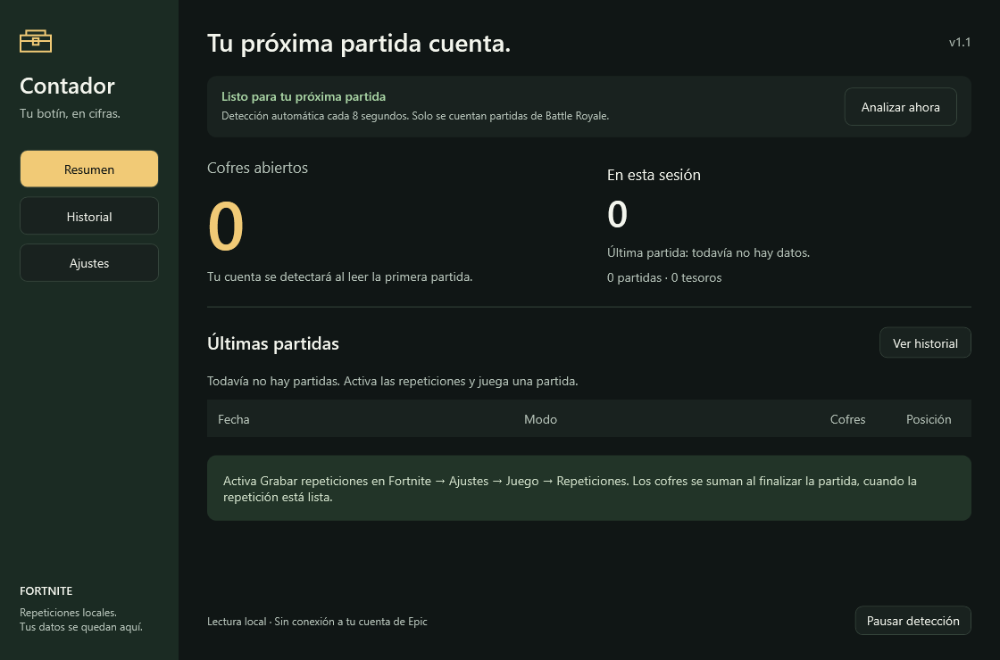
</p>

## Sin cuentas ni contraseñas

**Contador no te pide usuario, correo, contraseña, códigos de verificación ni acceso a tu cuenta de Epic Games.** No tienes que iniciar sesión ni introducir credenciales para utilizarlo.

El análisis se ejecuta localmente, en tu propio equipo, sobre los archivos de repetición que Fortnite ya guarda. El historial y los ajustes permanecen en tu carpeta de datos local. La app no envía estadísticas, no inyecta código ni modifica la memoria del juego. Solo tú decides si exportas o compartes algún archivo.

Utiliza las repeticiones generadas por Fortnite y un lector comunitario de código abierto; **no es una aplicación oficial ni está aprobada por Epic Games**. Leer esos archivos no permite prometer inmunidad a sanciones. Las condiciones aplicables las establece [Epic Games](https://legal.epicgames.com/epicgames/tos).

## Antes de abrir: seguridad y aviso de Windows

### ¿Por qué aparece «Windows protegió su PC»?

<p align="center">
  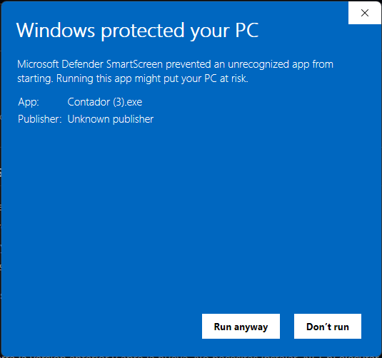
</p>

El ejecutable distribuido actualmente **no tiene una firma digital de editor verificado**. Microsoft Defender SmartScreen evalúa la reputación del archivo y de su editor; cuando no reconoce la aplicación puede mostrar este aviso y **Editor desconocido**.

**Este aviso, por sí solo, no significa que se haya detectado un virus. Tampoco demuestra que el archivo sea seguro.** Una firma válida identifica al editor, pero incluso una aplicación firmada puede mostrar avisos mientras acumula reputación. Puedes consultar la [explicación oficial de Microsoft](https://learn.microsoft.com/en-us/windows/apps/package-and-deploy/smartscreen-reputation) y nuestras [instrucciones de firma digital](docs/FIRMA.md).

No necesitas desactivar Defender ni SmartScreen, añadir exclusiones o instalar certificados del proyecto. Si tu antivirus muestra una detección concreta o no puedes comprobar el origen del archivo, no lo ejecutes y [comparte el resultado en una incidencia](https://github.com/Axxon-g/contador-cofres-fornite/issues).

### Consulta el análisis de VirusTotal

<p align="center">
  <a href="https://www.virustotal.com/gui/file/f0ebdf6c9a65c57b66b97957ab37574e96f32c136201fedcd97be4bb05e2a1c6">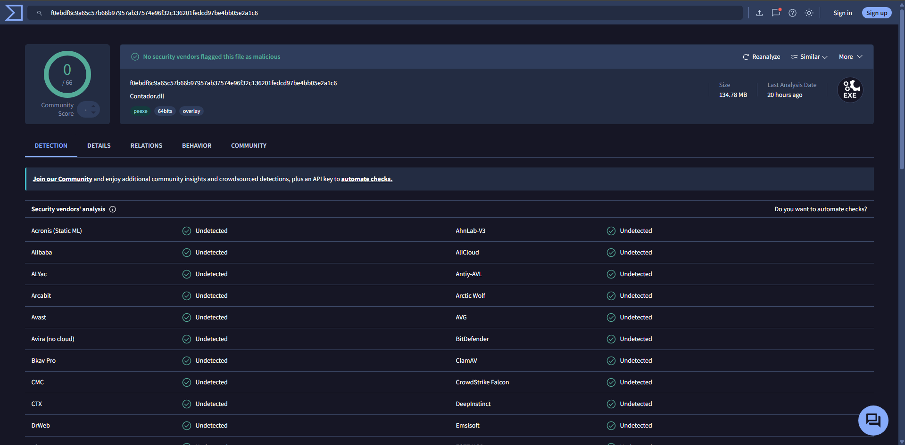</a>
</p>

La captura aportada muestra **0 detecciones entre 66 motores** en el momento en que se tomó. [Abre el informe en VirusTotal para consultar su estado](https://www.virustotal.com/gui/file/f0ebdf6c9a65c57b66b97957ab37574e96f32c136201fedcd97be4bb05e2a1c6).

Ese informe corresponde exclusivamente al archivo con este **SHA-256**:

```text
f0ebdf6c9a65c57b66b97957ab37574e96f32c136201fedcd97be4bb05e2a1c6
```

La huella del ejecutable local **1.2.5** se comprobó el **12 de noviembre de 2026** y coincide con este informe. Aunque VirusTotal muestre el nombre `Contador.dll`, la coincidencia se comprobó por SHA-256, no por nombre. Esto no verifica automáticamente otras descargas o futuras compilaciones. **Comprueba la huella o analiza tu propio archivo.** Un resultado sin detecciones no garantiza ausencia de malware ni constituye una certificación de seguridad.

### Comprueba tú mismo el archivo descargado

1. Descarga **Contador.exe** únicamente desde las [Releases de este repositorio](https://github.com/Axxon-g/contador-cofres-fornite/releases).
2. Antes de abrirlo, entra en [www.virustotal.com](https://www.virustotal.com/) y selecciona **File / Archivo → Choose file / Elegir archivo**.
3. Selecciona el ejecutable que acabas de descargar. Revisa y acepta las condiciones del servicio antes de enviarlo.
4. Espera el resultado y revisa las detecciones y la fecha del análisis. Haz esta comprobación con cada versión nueva si quieres verificar el archivo que vas a utilizar.

> [!NOTE]
> Subir el ejecutable a VirusTotal es una acción voluntaria que envía ese archivo a un servicio externo. No subas contraseñas, repeticiones, historiales ni otros archivos privados. El análisis local de partidas de Contador no requiere VirusTotal.

Si prefieres comparar el SHA-256 sin subir el archivo, abre PowerShell en su carpeta y ejecuta:

```powershell
Get-FileHash -LiteralPath .\Contador.exe -Algorithm SHA256
```

Solo si coincide exactamente con el SHA-256 anterior estás consultando el informe de ese mismo archivo. Si la Release incluye `Contador.exe.sha256`, también puedes comparar la huella con ese archivo; esto comprueba integridad, pero no sustituye una firma digital ni un análisis de seguridad.

## Primeros pasos

1. **Descarga [Contador.exe](https://github.com/Axxon-g/contador-cofres-fornite/releases/latest/download/Contador.exe)** y guárdalo en la carpeta que prefieras.
2. **Activa las repeticiones en Fortnite:** Ajustes → Juego → Repeticiones → **Grabar repeticiones**.
3. **Abre Contador.exe con doble clic.** El historial anterior compatible se recupera automáticamente si está en este equipo.
4. **Deja la app abierta mientras juegas.** Al terminar una partida de Battle Royale, analizará la repetición y sumará tus cofres.

Solo necesitas el ejecutable. No hace falta descargar el código, abrir VS Code ni ejecutar archivos de compilación.

Si la carpeta no se encuentra, entra en **Ajustes → Elegir carpeta**. La ubicación habitual es:

```text
%LOCALAPPDATA%\FortniteGame\Saved\Demos
```

## Todo tu botín, en un mismo sitio

| En la app | Para qué sirve |
|---|---|
| **Resumen** | Consulta el total de tu cuenta, la sesión, la última partida, la media y tu récord. |
| **Historial** | Busca por fecha o modo, ordena columnas y selecciona una partida para ver sus detalles. |
| **Mapa y rutas** | Explora capas de ubicaciones posibles, prepara recorridos y guarda marcas manuales. |
| **Informe** | Revisa estadísticas, gráficos y tesoros dentro de la app; abre el HTML si lo prefieres. |
| **Exportar CSV** | Guarda las partidas del perfil y filtro visibles para abrirlas en una hoja de cálculo. |
| **Perfiles** | Cambia entre las cuentas detectadas; sus estadísticas se mantienen separadas. |
| **Overlay** | Muestra las cifras sobre el juego y ajusta su tamaño desde la app. |
| **Pausar detección** | Detiene los siguientes análisis. El análisis que ya empezó termina normalmente. |
| **Datos locales** | Abre el informe, la carpeta de datos y el registro de errores desde Ajustes. |

<table>
  <tr>
    <td width="50%">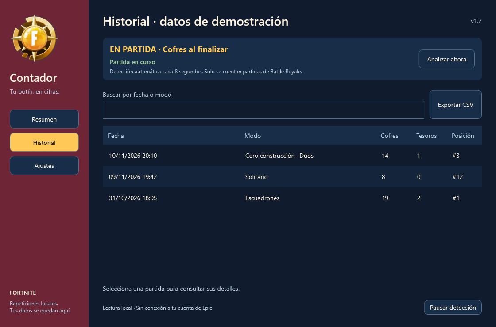<br><strong>Cada partida, en detalle.</strong></td>
    <td width="50%">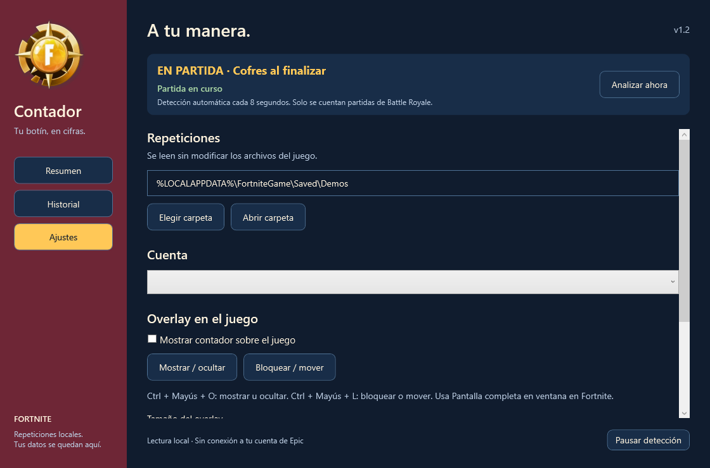<br><strong>El contador, a tu manera.</strong></td>
  </tr>
</table>

<sub>Vistas previas renderizadas desde la interfaz de la app. La tabla de historial utiliza datos de demostración; no se incluyen en el programa.</sub>

## Elegir una cuenta

Entra en **Ajustes → Cuenta** y selecciona el perfil. Cada opción muestra su nombre, partidas y cofres. Desde la versión **1.2.6**, el selector permanece disponible mientras se analizan repeticiones; si hay un análisis en curso, la elección se aplica al terminar. El resumen, historial, informe y overlays utilizan la cuenta elegida, que se recuerda al volver a abrir la app.

Solo aparecen cuentas con partidas detectadas o importadas en este equipo. No se consulta el historial de otras cuentas por Internet ni se necesitan sus credenciales.

## Contar desde una fecha o durante un evento

En **Ajustes → Fechas del contador** puedes elegir **Desde** y **Hasta**, incluidos ambos días. Pulsa **Aplicar fechas** para guardar la selección.

- Para empezar el **1 de noviembre de 2026**, pulsa **Desde 01/11/2026**. Aplica esa fecha inicial y deja el final abierto para seguir sumando nuevas partidas.
- Puedes dejar cualquiera de las dos fechas vacía para no limitar ese extremo.
- **Todo el historial** quita el filtro y recupera las cifras históricas sin borrar partidas.

El período activo aparece en la ventana y se aplica al resumen, historial, cofres, tesoros, última partida, sesión, informe, CSV y overlays. El selector conserva todas las cuentas conocidas y muestra sus cifras dentro del período. Las fechas se guardan al cerrar y abrir la aplicación.

Se usa la fecha local de Windows de inicio de la partida. Si un registro antiguo no contiene esa fecha, se utiliza la fecha en que fue analizado; esos registros pueden requerir revisar su origen. El filtro no recupera partidas que no estén guardadas ni convierte la fecha de análisis en una fecha de partida conocida.

Por defecto se conserva **Todo el historial**, también al actualizar desde versiones anteriores. Solo se cambia al elegir un período.

<p align="center">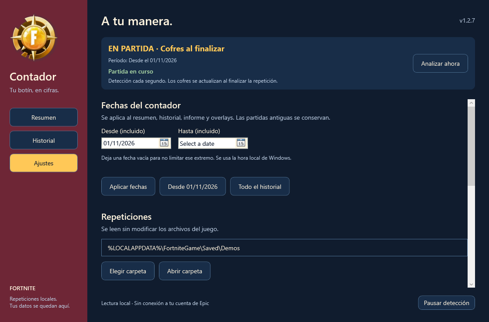</p>

## ¿Ya usabas otro contador?

**Abre la app y deja que recupere tu historial.** Desde la versión 1.1, Contador busca automáticamente los datos locales de **ChestCounter** y **ChestTracker**:

- Incorpora las partidas que faltan sin duplicar las que ya están guardadas.
- Si una partida tiene recuentos de distintas versiones, conserva el registro del analizador más reciente.
- Crea una copia de seguridad antes de guardar la incorporación.
- Mantiene los perfiles separados por cuenta.
- Lee el historial anterior sin modificar los archivos de la otra aplicación.

Los historiales se buscan en `%APPDATA%\ChestCounter\data.json` y `%APPDATA%\ChestTracker\data.json`. Los respaldos se guardan en `%APPDATA%\ContadorModern\Backups`.

La recuperación es local a cada equipo. No necesitas scripts ni copiar archivos. Si un historial está dañado o es incompatible, la app lo indica y vuelve a intentarlo al siguiente inicio. **Esta función incorpora datos a Contador; no sincroniza las aplicaciones entre sí.**

## Aviso de partida y contadores claros

La app comprueba la cabecera de las repeticiones cada dos segundos para detectar que Fortnite está grabando. Muestra **EN PARTIDA** en la ventana y en el overlay, incluso si la detección de cofres está pausada. Al dejar de grabarse, retira el aviso. La detección depende de que Fortnite haya creado y actualizado la repetición; no consulta la memoria del juego.

- **Última partida:** cofres de la partida finalizada más reciente.
- **Esta sesión:** cofres de las partidas jugadas desde que abriste la app. Se reinicia al abrirla y excluye el historial importado y las repeticiones antiguas reanalizadas.
- **Tesoros:** total de tesoros encontrados en el perfil seleccionado, con su etiqueta visible.

Última partida y sesión pueden coincidir si solo has terminado una partida durante esta ejecución. Los cofres siguen contabilizándose al finalizar; el aviso de partida no es un recuento instantáneo de cada apertura.

<p align="center">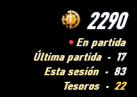</p>

La versión 1.2 incorpora una paleta azul marino, rojo y dorado de inspiración pirata y la moneda aportada como referencia visual, integrada en el ejecutable.

## Overlay para jugar y transmitir

Actívalo en **Ajustes → Mostrar contador sobre el juego**. En Fortnite, selecciona **Pantalla completa en ventana** para que Windows pueda mostrarlo encima.

| Atajo | Acción |
|---|---|
| <kbd>Ctrl</kbd> + <kbd>Mayús</kbd> + <kbd>O</kbd> | Mostrar u ocultar el overlay. |
| <kbd>Ctrl</kbd> + <kbd>Mayús</kbd> + <kbd>L</kbd> | Bloquear o desbloquear el overlay. |

Desbloquéalo para arrastrarlo a otra posición. Bloquéalo al jugar para que el ratón lo atraviese.

**Para OBS:** añade una fuente **Navegador**, activa **Archivo local** y selecciona `overlay.html` en la carpeta de datos. Puedes encontrarla desde **Ajustes → Abrir datos**. Desde la versión 1.2.3, la fuente de OBS usa el mismo HUD que aparece sobre el juego: moneda, fondo transparente, estado, última partida, sesión y tesoros. Se actualiza cada dos segundos sin recargar toda la página. Mantén la app abierta y conserva `overlay-data.js` junto a `overlay.html`; ambos se generan automáticamente. Si tenías la fuente anterior, actualízala una vez en OBS después de abrir esta versión. Usa inicialmente un ancho de 300 y alto de 180 píxeles, y ajusta la escala en la escena.

## Cómo funciona

Contador lee los archivos `.replay` que Fortnite guarda en tu equipo. Identifica al jugador que grabó la partida y los contenedores que abrió, con el lector de [LED-N/Fortnite-ChestCounter](https://github.com/LED-N/Fortnite-ChestCounter).

- Solo lee las repeticiones; no modifica el juego.
- No accede a la memoria de Fortnite ni a tus credenciales de Epic.
- Las cajas de munición y otros contenedores se distinguen de los cofres.
- Una partida renombrada no vuelve a sumarse.
- Los historiales y preferencias se guardan localmente; la app no envía estadísticas.

Desde la versión 1.2.5 se revisan las repeticiones cada segundo. Tras finalizar, se comprueba brevemente su estabilidad y se muestran primero las cifras; el informe se genera después. La duración real depende del tamaño del archivo y del equipo.

Fortnite escribe la clave necesaria para leer la repetición al finalizar la partida. Por eso el total se actualiza después, aunque la app esté abierta durante el juego.

### Diagrama del proyecto

<p align="center">
  <a href="https://gitdiagram.com/axxon-g/contador-cofres-fornite">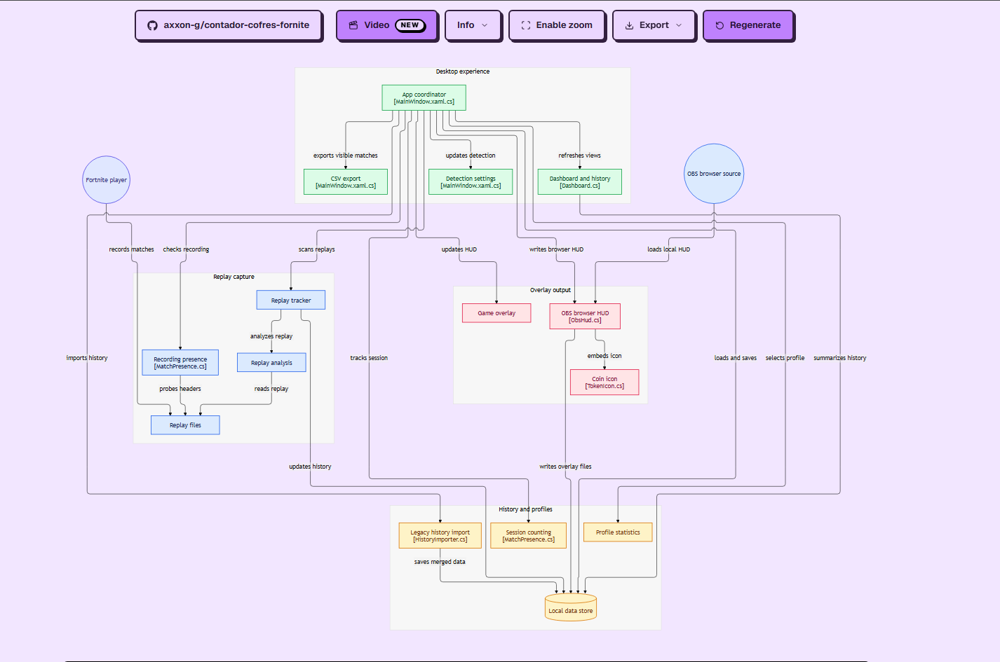</a>
</p>

[Explora el diagrama interactivo en GitDiagram](https://gitdiagram.com/axxon-g/contador-cofres-fornite) para ver los componentes y sus relaciones. En términos sencillos: **Fortnite guarda la repetición → Contador la lee y analiza → guarda el historial local → actualiza la ventana, el overlay y el informe**.

La imagen es una captura orientativa del diagrama generado por una herramienta externa; puede quedar desactualizada y no constituye una auditoría de seguridad. Puedes contrastarla con el código de este repositorio.

## Preguntas frecuentes

<details>
<summary><strong>No aparece ningún cofre. ¿Qué reviso?</strong></summary>

Comprueba que **Grabar repeticiones** está activado y que jugaste una partida de Battle Royale. Verifica la carpeta en Ajustes y deja terminar la partida. Si aparece un error, abre **Ajustes → Registro de errores**.

Fortnite puede crear la carpeta de repeticiones después de la primera partida grabada.

</details>

<details>
<summary><strong>El total es distinto al de mi contador anterior.</strong></summary>

Comprueba que estás viendo la misma cuenta y que la recuperación del historial terminó. Los totales también pueden diferir si las aplicaciones usan versiones distintas del analizador. Contador conserva el registro del analizador más reciente para una partida compartida; no suma ambos registros.

La importación recupera partidas conocidas por el contador anterior. No puede reconstruir partidas que ninguna aplicación guardó y cuya repetición ya no está disponible.

</details>

<details>
<summary><strong>¿Cuenta en tiempo real, mientras abro cada cofre?</strong></summary>

El recuento final se obtiene **después de la partida**, cuando Fortnite termina de escribir la repetición. Durante la grabación, la app puede indicar que hay una partida en curso.

</details>

<details>
<summary><strong>¿Qué pasa si Fortnite se cierra o cambia su formato?</strong></summary>

Una repetición incompleta o incompatible puede no contarse. Una actualización de Fortnite puede requerir actualizar el lector. El historial ya guardado se conserva.

Si necesitas ayuda, [abre una incidencia](https://github.com/Axxon-g/contador-cofres-fornite/issues) con la versión de la app y el mensaje de error. Revisa el registro antes de compartirlo: puede contener datos de tus partidas.

</details>

<details>
<summary><strong>¿Tengo que instalar .NET o descargar “Source code”?</strong></summary>

No. Para usar la app, descarga **Contador.exe** en la sección **Assets** de una Release. Los archivos **Source code (zip)** y **Source code (tar.gz)** contienen el código para desarrolladores.

</details>

<details>
<summary><strong>¿Cómo actualizo la app sin perder mis partidas?</strong></summary>

Cierra Contador, descarga el nuevo ejecutable desde [Releases](https://github.com/Axxon-g/contador-cofres-fornite/releases) y reemplaza el ejecutable anterior. El historial se guarda en una carpeta independiente, no dentro del archivo .exe.

</details>

## Tus datos

Desde **Ajustes → Abrir datos** puedes acceder a `%APPDATA%\ContadorModern`.

| Archivo o carpeta | Contenido |
|---|---|
| `data.json` | Historial de partidas. |
| `config.json` | Preferencias y cuenta seleccionada. |
| `mapa-crossbones-43.10-20261113.json` | Capas, ruta y revisiones manuales del mapa 43.10, separadas del historial. |
| `Backups/` | Respaldos de la importación automática. |
| `report.html` | Informe con los colores, moneda y tipografía del launcher. Se regenera automáticamente. |
| `overlay.html` | HUD transparente para la fuente Navegador de OBS. |
| `overlay-data.js` | Cifras y estado actualizados automáticamente por la app. |
| `matches.csv` | Exportación generada del historial. |
| `errors.log` | Diagnóstico, cuando se registran errores. |

Para hacer un respaldo o cambiar de equipo, copia la carpeta de datos con Contador cerrado.

<details>
<summary><strong>Para desarrolladores: compilar y comprobar</strong></summary>

Instala el [SDK de .NET 10 para Windows x64](https://dotnet.microsoft.com/download/dotnet/10.0) y ejecuta desde la raíz del proyecto:

```powershell
.\build.bat
```

El script utiliza la versión de `src/Contador/Contador.csproj` para elegir la carpeta de salida. Al preparar la versión `1.3.0`, el destino será `dist\1.3.0\Contador.exe`. La configuración actual sigue siendo `1.2.7`; cambiar el README no cambia el ejecutable. La primera compilación necesita conexión para restaurar dependencias.

Para desarrollar o ejecutar las comprobaciones:

```powershell
dotnet run --project src/Contador/Contador.csproj
dotnet run --project tests/Contador.Checks/Contador.Checks.csproj -c Release
dotnet run --project tests/Contador.DesktopChecks/Contador.DesktopChecks.csproj -c Release

# Comprobaciones específicas de las nuevas funciones
dotnet run --project tests/Contador.Checks/Contador.Checks.csproj -c Release -- --map-only
dotnet run --project tests/Contador.Checks/Contador.Checks.csproj -c Release -- --report-only
dotnet run --project tests/Contador.DesktopChecks/Contador.DesktopChecks.csproj -c Release -- --map-ui-only
dotnet run --project tests/Contador.DesktopChecks/Contador.DesktopChecks.csproj -c Release -- --instance-only
```

Durante la preparación de estas funciones pasaron **48 comprobaciones del mapa**, **18 de interfaz**, **4 de caché HD** y **8 de instancia única**, en sus respectivas ejecuciones. La suite general de almacenamiento quedó bloqueada por permisos del entorno; no se considera aprobada. Antes de publicar la compilación 1.3 deben ejecutarse sus comprobaciones. Las capturas y pruebas no sustituyen validar el lector con nuevas versiones de Fortnite ni acreditan una sesión HD completa por Internet.

Conserva `vendor/`: contiene el lector y sus dependencias de código necesarias para compilar. Para usar el programa publicado basta con `Contador.exe`; no distribuyas carpetas de AppData ni historiales personales.

Consulta [cómo publicar el ejecutable en GitHub Releases](docs/PUBLICAR.md) y el [estado de verificación](VERIFICACION.md).

</details>

## Créditos y licencia

[MIT](LICENSE). La interfaz de escritorio utiliza el motor de [LED-N/Fortnite-ChestCounter](https://github.com/LED-N/Fortnite-ChestCounter), basado en [FortniteReplayDecompressor de Shiqan](https://github.com/Shiqan/FortniteReplayDecompressor) y OozSharp. Se conservan sus licencias y notas en [vendor/ChestCounter](vendor/ChestCounter) y [vendor/UPSTREAM.md](vendor/UPSTREAM.md).

Este proyecto no está afiliado, aprobado ni patrocinado por Epic Games. Fortnite es una marca de Epic Games.

<div align="center">
  <br>
  <a href="https://github.com/Axxon-g/contador-cofres-fornite/releases/latest/download/Contador.exe"><strong>Descargar Contador para Windows</strong></a>
  <p>Abre la app. Juega tu partida. Consulta tu botín.</p>
</div>
