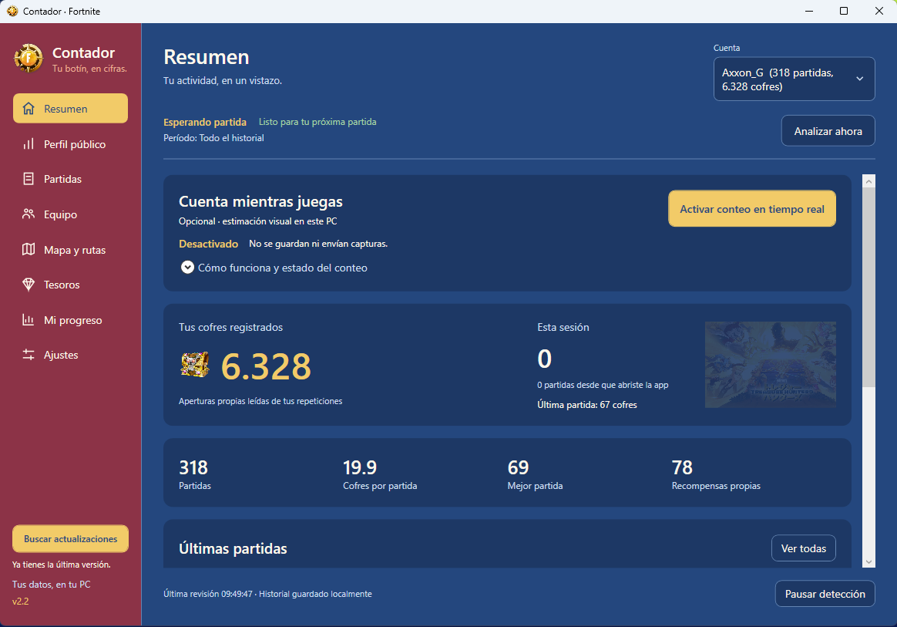
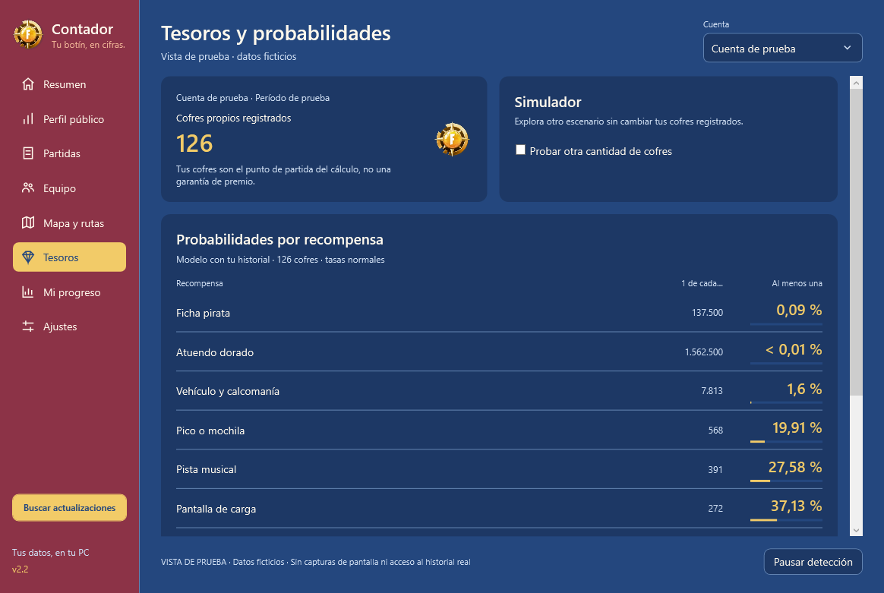
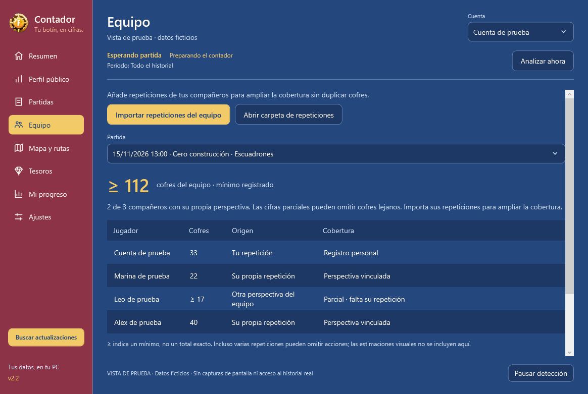
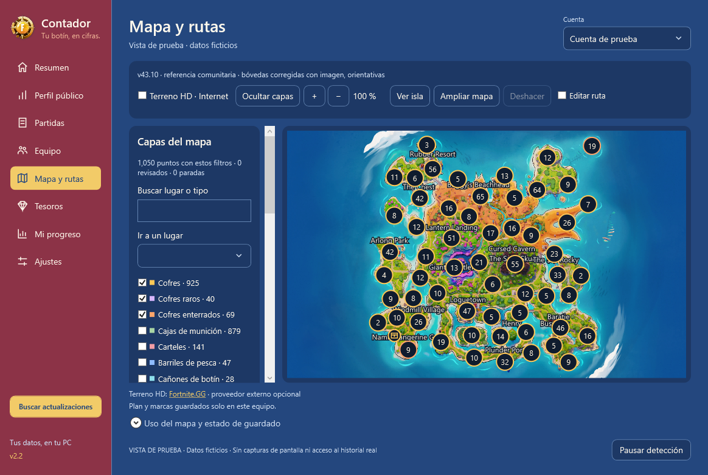
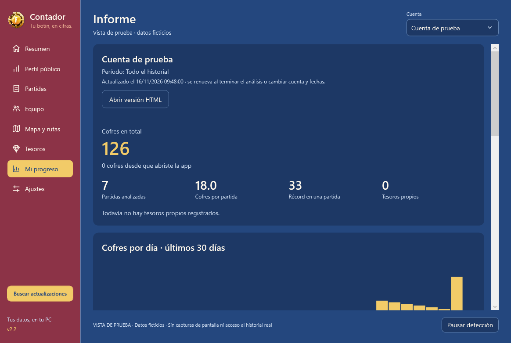
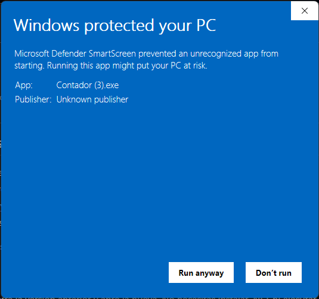

<div align="center">
  
  <h1>Contador de cofres para Fortnite · 2.2</h1>
  <p><strong>Tu botín, en cifras.</strong><br>Historial personal, mapa, tesoros, progreso y overlay para Windows.</p>
  <p>
    
    
    <a href="https://github.com/Axxon-g/contador-cofres-fornite/releases"></a>
    <a href="LICENSE"></a>
  </p>
  <p>
    <a href="https://github.com/Axxon-g/contador-cofres-fornite/releases/latest/download/Contador.exe"></a>
  </p>
  <p><a href="https://github.com/Axxon-g/contador-cofres-fornite/releases/latest/download/Contador.exe">Descarga directa de Contador.exe</a> · <a href="https://github.com/Axxon-g/contador-cofres-fornite/releases">Todas las versiones y notas de actualización</a></p>
  <p><a href="#primeros-pasos">Primeros pasos</a> · <a href="#equipo--experimental">Equipo</a> · <a href="#conteo-en-tiempo-real--experimental">Tiempo real</a> · <a href="#seguridad-y-privacidad">Seguridad</a> · <a href="#compilar-desde-el-código">Compilar</a></p>
  <p><strong>Sin iniciar sesión ni introducir contraseñas de Epic.</strong></p>
</div>

> [!IMPORTANT]
> El historial se calcula con **repeticiones locales finalizadas**. Activa **Grabar repeticiones** en Fortnite. El conteo visual en tiempo real es opcional y experimental; no sustituye al historial ni garantiza detectar cada apertura.

La descarga apunta a la última Release **publicada** en GitHub. Este código prepara
**Contador 2.2**: el nuevo ejecutable estará disponible en ese botón cuando se adjunte
y publique la Release. La insignia cuenta descargas del archivo, no personas únicas.

## Lo nuevo en 2.2

| Función | Qué puedes hacer |
|---|---|
| **Interfaz por bloques** | Resumen, Mapa, Tesoros y Mi progreso separan cifras, controles y detalles. Rojo pirata, azul moderado y dorado. |
| **Conteo visual visible** | Activa una estimación mientras juegas desde el botón de Resumen, con permiso por ejecución. |
| **Tesoros y probabilidades** | Compara recompensas, prueba cantidades y simula Horas del tesoro sin cambiar tu historial. |
| **Mi progreso** | Consulta totales, gráfica diaria, tipos de cofre, origen de recompensas y partidas. Conserva la versión HTML. |
| **Perfil público** | Busca por nombre y consulta rendimiento, modalidades, eliminaciones por partida y tiempo jugado cuando estén disponibles. |
| **Actualizaciones sugeridas** | Busca en GitHub al iniciar o reabrir la ventana. El botón indica si hay una nueva versión; la instalación es manual. |
| **Recuperación de lectura** | Reintentos limitados ante errores temporales y opción para reintentar archivos fallidos desde Ajustes. |
| **Herramientas locales** | Copia opcional de nuevas repeticiones analizadas y diagnóstico sin nombres, ID, rutas ni claves. |

El equipo y el conteo visual siguen siendo **experimentales**. Las probabilidades
usan tasas comunitarias sin verificar con Epic; no confirman premios ni predicen
el siguiente cofre. No se integra un servicio de amigos ni se prometen cofres exactos
al buscar un nombre.

<p align="center">
  
  <br><sub>Captura real aportada por el autor; sus cifras no se incluyen en la descarga.</sub>
</p>

<p align="center">
  
  <br><sub>Vista con datos de ejemplo para mostrar la interfaz.</sub>
</p>

[Notas de Contador 2.2](docs/RELEASE-v2.2.md) ·
[Diseño](docs/DISENO-2.2.md) · [Probabilidades y límites](docs/PROBABILIDADES.md).

## Primeros pasos

1. Pulsa **Descargar Contador.exe** en el botón de arriba o utiliza la [descarga directa](https://github.com/Axxon-g/contador-cofres-fornite/releases/latest/download/Contador.exe). También puedes elegir una versión desde [GitHub Releases](https://github.com/Axxon-g/contador-cofres-fornite/releases). No necesitas descargar el código fuente.
2. Activa **Grabar repeticiones** en Fortnite y juega una partida compatible con el lector.
3. Abre Contador. En **Ajustes**, comprueba la carpeta de repeticiones; puedes elegirla si no se detecta automáticamente.
4. Selecciona tu **Cuenta** en la cabecera. Solo aparecen perfiles encontrados en el historial local.
5. Al terminar la partida, espera a que Fortnite finalice el archivo. La app analiza la repetición y actualiza las cifras.

**Requisitos:** Windows x64, repeticiones guardadas en ese equipo y espacio para ellas. El ejecutable incluye .NET; no necesitas instalar el SDK para usarlo. El OCR opcional requiere Windows 10 versión 2004 o posterior, un idioma de reconocimiento instalado y un HUD compatible.

**Al actualizar:** sal desde la bandeja de Windows → **Salir**, sustituye `Contador.exe` y abre la versión nueva. No borres `%APPDATA%\ContadorModern`: allí están el historial y las preferencias. La migración conserva un respaldo previo; solo puede volver a analizar repeticiones que todavía existan.

## Estadísticas públicas sin claves de usuario

El apartado **Perfil público**, debajo de Resumen, permite buscar por nombre Epic, PlayStation o Xbox, o utilizar el perfil local. La consulta pasa por el servicio de AXXON; los usuarios no configuran claves y el ejecutable no incluye la clave del proveedor. [Configuración del servicio y límites](docs/ESTADISTICAS-2.0.md).

El servicio está disponible en [AXXON](https://www.axxon.dev/fortnite-tracker/). El nombre o ID público y los filtros se envían a AXXON y Fortnite-API; el alojamiento puede registrar datos técnicos de la consulta, incluida la dirección IP. Los resultados pueden proceder de una caché de hasta cinco minutos. Las cuentas privadas o los límites del proveedor pueden impedir una consulta. No se muestran datos ficticios como resultado real.

## Equipo · experimental

Tu repetición puede omitir aperturas lejanas de compañeros. **≥ significa mínimo registrado, no total exacto del servidor.** Incluso varias perspectivas pueden seguir siendo incompletas.

1. Deja que termine el análisis de tu partida.
2. Abre **Equipo** y selecciona la partida.
3. Pulsa **Importar repeticiones del equipo** y elige archivos `.replay` finalizados que te hayan compartido tus compañeros de esa misma partida.
4. Revisa las columnas **Jugador**, **Cofres**, **Origen** y **Cobertura**.

La app verifica sesión e identidad y que el grabador pertenezca al equipo conocido; no vincula fuentes solo por nombre. Conserva la mejor cifra disponible por jugador, sin sumar varias veces una misma contribución. Una observación desde otro compañero sigue siendo parcial.

<p align="center">
  
  <br><sub>Vista de prueba con datos ficticios para explicar las fuentes; no se incluyen en el historial del usuario.</sub>
</p>

- Los archivos se analizan localmente; no se suben ni se copian a un servidor.
- Puedes retirar una fuente individual o todas las fuentes importadas sin borrar sus archivos ni tu historial personal.
- Un archivo no apto no impide aprovechar otros válidos del lote. Se admiten hasta 20 archivos por operación y 1.000 resúmenes.
- Las importaciones del equipo no cambian tus cofres ni tus recompensas personales.
- El resumen acumulado distingue tus cofres y los compañeros detectados. La cobertura muestra las partidas que carecen de datos.

Consulta la [investigación y sus límites](docs/INVESTIGACION-v2.0.md). Todavía falta validar varias perspectivas de una misma partida frente a un conteo manual completo; no se anuncia precisión perfecta.

## Conteo en tiempo real · experimental

En **Resumen**, pulsa **Activar conteo en tiempo real**. La app explica la captura y pide permiso; rechazar mantiene el análisis de repeticiones. Puedes desactivarlo en cualquier momento. El permiso no se guarda: al volver a abrir empieza desactivado.

El botón de activación permanece visible en el primer bloque de Resumen, como se muestra en la captura de arriba.

| Cifra | Cómo interpretarla |
|---|---|
| **Total personal** | Historial de repeticiones del perfil y período seleccionados. |
| **≈ estimación visual** | Avisos de cofres con XP/PE reconocidos en pantalla; puede omitir o duplicar detecciones. |
| **Equipo de la última partida** | Cifras del replay finalizado y fuentes vinculadas; no un conteo en directo de todos los compañeros. |

Solo se procesan regiones del HUD de Fortnite en primer plano, en memoria. No se guardan ni envían capturas. Se pausa al perder el foco, detener la detección o dejar de detectarse una partida.

Los cofres rotos sin aviso XP/PE, HUD personalizado, cambios de escala y errores de reconocimiento pueden producir diferencias. El resultado final de la repetición se calcula por separado: **no se suma la estimación visual al historial**. [Funcionamiento, permiso y limitaciones](docs/LECTURA-VISUAL-2.0.md).

## Mapa, rutas y Mi progreso

**Mapa y rutas** permite acercar, desplazar, buscar, activar capas, seleccionar puntos y crear recorridos manuales. La base integrada funciona sin conexión. **Terreno HD · Internet** está activado por defecto y utiliza piezas de Fortnite.GG con caché local y respaldo integrado; puedes desactivarlo.

El catálogo integrado corresponde a Treasure Hunters **43.10**: 2.146 referencias comunitarias de botín y 16 lugares. Es una instantánea fija, **no se actualiza con cada temporada**, no detecta el botín durante la partida y no garantiza premios. Las bóvedas son referencias orientativas. Las rutas unen paradas manuales; no calculan un camino transitable.

**Mi progreso** reúne totales, sesión, media, récord, tipos de cofre, tesoros y partidas sin salir del programa. Conserva **Abrir versión HTML**. Los filtros de **Ajustes → Fechas del contador** se aplican al resumen, historial, equipo, informe y overlays sin borrar partidas.

- [Controles y procedencia del mapa](docs/MAPA-INTERACTIVO-1.2.7.md)
- [Terreno HD, privacidad y proveedor externo](docs/MAPA-HD-1.2.7.md)
- [Rutas y fuentes comunitarias](docs/RUTAS-1.2.7.md)

<details>
<summary><strong>Ver Mapa y Mi progreso en Contador 2.2</strong></summary>




Vistas de la interfaz con datos de ejemplo, sin acceso al historial real del usuario.
</details>

## Overlay y segundo plano

Activa el overlay desde **Ajustes** y utiliza Fortnite en pantalla completa en ventana para permitir que Windows lo muestre encima.

| Atajo | Acción |
|---|---|
| **Ctrl + Mayús + O** | Mostrar u ocultar el overlay. |
| **Ctrl + Mayús + L** | Bloquear o desbloquear su posición. |

Para OBS, añade una fuente **Navegador → Archivo local** y selecciona `overlay.html` desde la carpeta de datos. Conserva `overlay-data.js` a su lado; ambos se generan automáticamente. Mantén Contador abierto.

Al cerrar la ventana puedes **Mantener en segundo plano**, **Salir** o **Cancelar**. La moneda junto al reloj permite abrir Contador o salir con el menú contextual. Si no aparece, revisa **Mostrar iconos ocultos** de Windows.

## Actualizaciones

Al iniciar o volver a abrir la ventana desde la bandeja, Contador consulta la última
Release estable del repositorio oficial. Puedes comprobarla también desde la barra
lateral o Ajustes:

- **Buscar actualizaciones:** comprueba si hay una versión posterior.
- **Nueva actualización:** abre las descargas oficiales en tu navegador.
- **Ya tienes la última versión:** confirma que no se encontró una posterior.

Un fallo de conexión se muestra como tal. No se descargan ni ejecutan archivos
automáticamente. Esta consulta no envía cuentas, historial ni capturas; GitHub recibe
la conexión de red habitual y un identificador genérico de la aplicación.

## Si falla una repetición

Comprueba la carpeta, el perfil y las fechas. Deja que Fortnite termine de guardar.
En Ajustes puedes **Reintentar archivos fallidos** sin borrar las partidas correctas
y **Exportar diagnóstico sin datos personales** para informar de un problema.

La opción **Guardar copia local de las repeticiones analizadas** está apagada por
defecto. Solo conserva nuevas repeticiones compatibles analizadas; ocupa espacio,
no recupera archivos borrados y no los sube a ningún servidor.

Una actualización del formato de Fortnite puede requerir cambios del lector.
La versión 2.2 no garantiza resolver todos los archivos incompatibles.

## Seguridad y privacidad

**No se piden contraseñas, correo, códigos de verificación ni acceso a tu cuenta de Epic.** Los perfiles se identifican a partir de repeticiones locales. El historial y los ajustes se guardan en `%APPDATA%\ContadorModern`.

El análisis no modifica el juego ni lee su memoria. El conteo visual requiere permiso y no guarda ni envía capturas. Consultar **Perfil público** envía únicamente el nombre o ID público y los filtros al servicio de AXXON y a Fortnite-API; no transmite replays, capturas ni historial local. La opción de usar la cuenta seleccionada puede actualizar esa consulta al cambiar de perfil después de buscar. El modo HD realiza conexiones a Fortnite.GG para obtener imágenes, y abrir enlaces utiliza tu navegador.

Contador usa un lector comunitario sobre archivos generados por Fortnite. **No es oficial ni está aprobado por Epic Games; no se garantiza inmunidad a sanciones.**

### Aviso de Windows

<p align="center"></p>

El ejecutable no tiene firma de editor verificado. Windows puede mostrar **Windows protegió su PC** o **Editor desconocido** por reputación insuficiente. El aviso no demuestra que haya un virus, ni garantiza que el archivo sea seguro. No necesitas desactivar el antivirus, crear exclusiones ni instalar certificados del proyecto.

Si aparece una detección concreta o no puedes comprobar su origen, no lo ejecutes y [comparte el resultado](https://github.com/Axxon-g/contador-cofres-fornite/issues). [Información de firma](docs/FIRMA.md).

### Comprueba el archivo que descargues

Puedes subir **tu copia del ejecutable** a [VirusTotal](https://www.virustotal.com/) antes de abrirla. El [análisis compartido anteriormente](https://www.virustotal.com/gui/file/f0ebdf6c9a65c57b66b97957ab37574e96f32c136201fedcd97be4bb05e2a1c6) corresponde a otro archivo y **no acredita esta compilación 2.2**. Ningún resultado aislado garantiza ausencia de malware.

Para calcular su huella en PowerShell:

```powershell
Get-FileHash .\Contador.exe -Algorithm SHA256
```

Compara el resultado con la huella publicada para esa misma Release, si está disponible. La coincidencia verifica la identidad del archivo, no su seguridad por sí sola. El código y las dependencias están disponibles para revisión.

## Preguntas frecuentes

<details>
<summary><strong>¿Por qué no se actualiza al abrir cada cofre?</strong></summary>

El historial depende de que Fortnite finalice la repetición. El conteo visual opcional observa avisos XP/PE y es aproximado; no puede ver aperturas que no produzcan un aviso compatible.
</details>

<details>
<summary><strong>¿Funciona en consolas o GeForce NOW?</strong></summary>

Esta versión es una app de Windows que necesita repeticiones locales. No obtiene esos archivos automáticamente desde una consola ni desde el equipo remoto de GeForce NOW. Introducir un nombre de usuario no recupera sus cofres mediante una API pública.
</details>

<details>
<summary><strong>¿Por qué mi equipo muestra menos cofres de los que abrió?</strong></summary>

Las repeticiones pueden omitir acciones de compañeros, especialmente lejanas. Importar sus perspectivas mejora la cobertura; no convierte el registro en un total exacto del servidor. Revisa la columna Origen y el indicador ≥.
</details>

<details>
<summary><strong>¿Puedo recuperar mi historial anterior?</strong></summary>

La app busca historiales locales de ChestCounter y ChestTracker, incorpora partidas sin duplicarlas y conserva respaldos. No sincroniza equipos ni recupera archivos eliminados de Fortnite. Puedes elegir la cuenta en la cabecera y revisar las fechas en Ajustes.
</details>

<details>
<summary><strong>¿Qué hago si no aparece ningún cofre o falla un replay?</strong></summary>

Comprueba Grabar repeticiones, carpeta, cuenta y período. Deja terminar la partida y revisa Ajustes → Registro de errores. Una actualización del formato de Fortnite puede requerir cambios del lector; no toda repetición es compatible.
</details>

## Compilar desde el código

Necesitas el **SDK de .NET 10** en Windows x64. Conserva `vendor`: contiene el lector y las bibliotecas necesarias. El SDK no es necesario para ejecutar la descarga ya compilada.

```powershell
git clone https://github.com/Axxon-g/contador-cofres-fornite.git
cd contador-cofres-fornite
.\build.bat
```

El script comprueba el motor y los controles de escritorio y genera **`dist\2.2.0\Contador.exe`**. Cierra la app antes de sustituir ese archivo. La publicación es autocontenida; no hace falta distribuir los archivos de código ni ejecutar scripts en el equipo del usuario.

```text
src/Contador/              Interfaz WPF, captura opcional y coordinación
src/Contador.Engine/       Reglas, fuentes, historial, informes y mapa
tests/                    Comprobaciones del motor y de escritorio
vendor/                   Lector y dependencias con sus licencias
docs/                     Uso, seguridad, investigación y versiones
```

- [Notas de la versión 2.2](docs/RELEASE-v2.2.md) · [Versión 2.0.1](docs/RELEASE-v2.0.1.md) · [Versión 2.0](docs/RELEASE-v2.0.0.md)
- [Arquitectura](docs/ARQUITECTURA.md) · [Verificación y límites](VERIFICACION.md)
- [Investigación de lectores y conciliación](docs/INVESTIGACION-v2.0.md)
- [Procedencia y licencias de dependencias](vendor/UPSTREAM.md)
- Versiones anteriores: [1.3.2](docs/RELEASE-v1.3.2.md), [1.3.1](docs/RELEASE-v1.3.1.md), [1.3](docs/RELEASE-v1.3.0.md).

## Créditos

Basado en el lector de [LED-N/Fortnite-ChestCounter](https://github.com/LED-N/Fortnite-ChestCounter). Las referencias adicionales y decisiones adoptadas están documentadas en la investigación; los avisos aplicables se conservan en `vendor`.

Fortnite y los recursos del juego pertenecen a sus titulares. Las imágenes aportadas se usan para identificar y mostrar este proyecto comunitario. La licencia MIT del código no concede derechos sobre esas marcas o recursos. El terreno HD es un servicio externo de Fortnite.GG.
